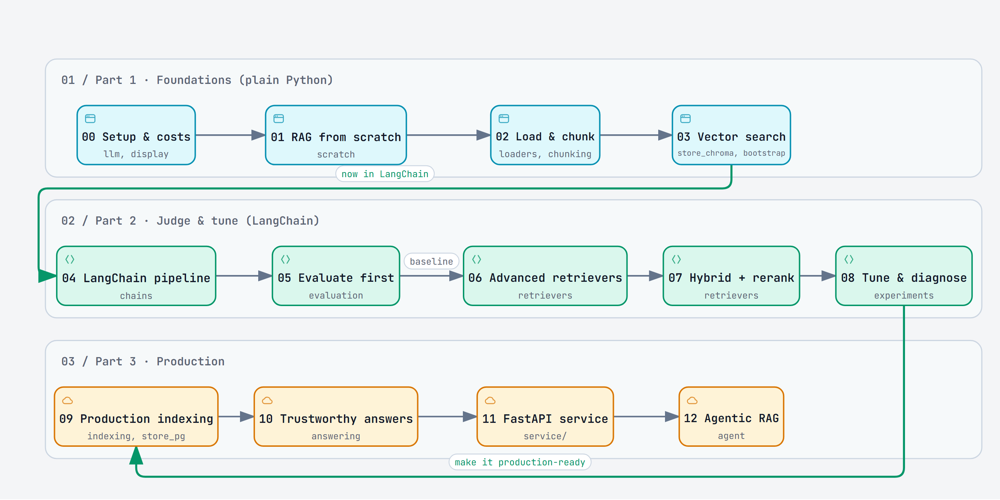

# RAG-lab: Retrieval-Augmented Generation, from scratch to production

A hands-on notebook series for developers who want to understand RAG well enough to build it, judge
it and ship it. You start with 40 lines of plain Python and finish with an evaluated, defended
FastAPI service and an agent that decides when to search.

> **Token Hotels & Resorts is fictional.** Every hotel, document, name, price and review in this repo
> was invented for teaching. Any resemblance to a real business is coincidental, and the project is
> not affiliated with any company.

## What you'll be able to do

1. **Judge and tune someone else's RAG system.** Build an eval set, measure retrieval separately
   from generation, triage every failure, and know which fix to try first.
2. **Run a RAG service you can adapt and deploy.** Incremental indexing, cited and verified answers,
   prompt-injection defences, and a FastAPI app with auth, rate limits and cost logging, plus a
   Cloud Run + Neon deploy guide.
3. **Build an agent that decides when to search**, with a plain tool loop and with LangGraph, and
   measure whether it beats a fixed pipeline.



## The notebooks

Every notebook runs on its own: it builds (or reuses) the index it needs, so you can start anywhere.
Times and costs are for a default run with `gpt-6-luna` and the embedding cache already warm
(the very first notebook you run embeds the corpus once, for under $0.01).

| # | Notebook | You learn | Time | Cost |
|---|---|---|---|---|
| 00 | [Setup and costs](notebooks/00_setup_and_costs.ipynb) | Your key, the cost meter, what a token costs | 7 s | < $0.001 |
| 01 | [RAG from scratch](notebooks/01_rag_from_scratch.ipynb) | The whole idea in plain Python: embed, retrieve, prompt | 8 s | $0.0001 |
| 02 | [Loading and chunking](notebooks/02_loading_and_chunking.ipynb) | PDF, HTML, Markdown and CSV; chunk size, overlap, metadata | 5 s | $0 |
| 03 | [Vector search](notebooks/03_vector_search.ipynb) | A real vector database (Chroma), filters, MMR | 6 s | $0 |
| 04 | [The pipeline in LangChain](notebooks/04_pipeline_in_langchain.ipynb) | The same pipeline as LCEL chains, a grounded prompt | 14 s | $0.0005 |
| 05 | [Evaluate before optimising](notebooks/05_evaluate_before_optimising.ipynb) | An eval set, retrieval metrics, an LLM judge, RAGAS | 38 s | $0.006 |
| 06 | [Advanced retrievers](notebooks/06_advanced_retrievers.ipynb) | MultiQuery, compression, SelfQuery, measured honestly | 16 s | $0.001 |
| 07 | [Hybrid search and reranking](notebooks/07_hybrid_and_rerank.ipynb) | BM25, reciprocal rank fusion, a local cross-encoder | 19 s | $0 |
| 08 | [Tuning lab](notebooks/08_tuning_lab.ipynb) | Tuning grids, failure triage, diagnosing a broken system | 23 s | $0.002 |
| 09 | [Production indexing](notebooks/09_production_indexing.ipynb) | Incremental sync, de-duplication, versions, pgvector | 14 s | $0.0001 |
| 10 | [Answers you can trust](notebooks/10_trustworthy_answers.ipynb) | Verified citations, refusals, prompt-injection defence, streaming | 25 s | $0.002 |
| 11 | [Ship it: a FastAPI service](notebooks/11_fastapi_service.ipynb) | Auth, rate limits, validation, cost logging, Docker, deploying | 25 s | $0.002 |
| 12 | [Agentic RAG](notebooks/12_agentic_rag.ipynb) | Tools, a tool loop, LangGraph, agent vs pipeline | 33 s | $0.002 |

The expensive evaluations (full eval set, RAGAS, tuning grids, agent comparison) were run once with
`RAGLAB_FULL_RUN=1` and saved in [`results/`](results/). By default, notebooks show those saved
results instead of paying for them again. Running all 13 notebooks costs about $0.02 by default; the full
run that produced `results/` cost $0.21 in total.

## Setup

You need Python 3.12, [uv](https://docs.astral.sh/uv/) and an OpenAI API key.

```bash
git clone <this repo> RAG-lab && cd RAG-lab
uv sync                      # the core: enough for notebooks 00-06 and 08-10
cp .env.example .env         # then put your OPENAI_API_KEY in .env
```

Optional extras, per part of the series:

| Extra | Install | Needed for | Note |
|---|---|---|---|
| `rerank` | `uv sync --extra rerank` | the cross-encoder reranker in notebook 07 | Installs PyTorch: a large download (hundreds of MB on Windows and macOS, several GB on Linux, where it pulls CUDA libraries). Without it, notebook 07 skips the reranker and still runs. |
| `prod` | `uv sync --extra prod` | pgvector (notebook 09), the FastAPI service (notebook 11) | |
| `agent` | `uv sync --extra agent` | the LangGraph half of notebook 12 | Without it, the tool-loop half still runs. |
| `dev` | `uv sync --extra dev` | rebuilding the notebooks and diagrams | |

`uv sync --all-extras` installs everything. Open the notebooks in VS Code (pick the `.venv`
kernel) or run `uv run --with jupyterlab jupyter lab`.

## Costs and safety

- **Model choice.** The default chat model is `gpt-6-luna` ($0.10 / $0.50 per million input/output
  tokens) with `text-embedding-3-small` for embeddings. Change it with `RAGLAB_CHAT_MODEL` in `.env`.
- **Every notebook prints what it spent** (`cost.report()` in the last cell), and API-heavy cells
  estimate their cost before they run.
- **Embeddings are cached on disk** (`.cache/`), so re-running a notebook doesn't re-embed anything.
- **Your key stays local.** `.env` is git-ignored; never commit it.
- **The service is the one place real money can leak**: an open `/ask` endpoint spends your OpenAI
  budget. That's why it requires an API key and rate-limits each key. Read the cost section of
  [`service/README.md`](service/README.md) before deploying.

## The service

```bash
uv sync --extra prod
uv run uvicorn service.app.main:app --reload     # needs RAGLAB_SERVICE_API_KEY in .env
```

[`service/README.md`](service/README.md) covers the API, Docker, and a step-by-step deploy to Google
Cloud Run with a free Neon Postgres (pgvector), including budget alerts and instance caps.
Notebook 11 starts the service and tests it from the notebook.

## Repository layout

| Path | What's there |
|---|---|
| `notebooks/` | The 13 notebooks, committed with their outputs |
| `notebooks/_src/` | Their sources ([jupytext](https://jupytext.readthedocs.io/) percent format): edit these, then rebuild |
| `raglab/` | The shared package the notebooks grow, one module per topic |
| `service/` | The FastAPI service, Dockerfile and deploy guide |
| `data/corpus/` | The 9 fictional source documents (Markdown, HTML, PDF, CSV) |
| `data/eval/questions.json` | 40 labelled eval questions in 7 categories |
| `data/_build/` | The facts and templates the corpus is generated from |
| `diagrams/` | Every diagram as JSON source, interactive HTML, SVG and PNG |
| `results/` | Saved full-run evaluation results |
| `tools/` | `build_notebooks.py` (build and execute notebooks) and `render_diagram.py` |

To rebuild a notebook after editing its source:

```bash
uv sync --extra dev
uv run python tools/build_notebooks.py 05_evaluate_before_optimising
```

## Credits and licences

- The code, notebooks, corpus and text are released under the [MIT License](LICENSE).
- Diagrams were made with [Archify](https://github.com/tt-a1i/archify). The interactive pages in
  `diagrams/*.html` embed Archify's viewer runtime, which is licensed under the Apache License 2.0;
  the licence text is included in each page.
